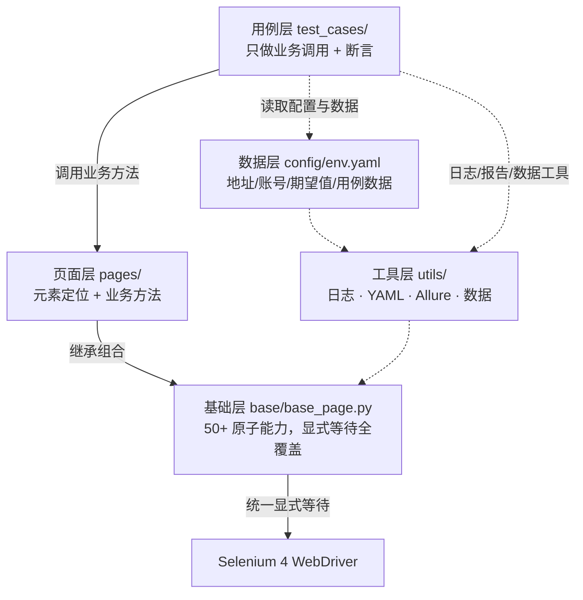
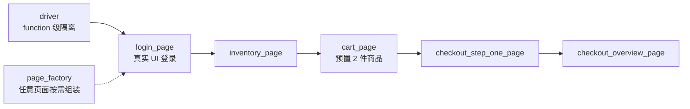

# Web 商城 UI 自动化测试框架（Python + Selenium 4）

一个面向企业交付场景的 **Web UI 自动化测试框架**，基于 Python + Selenium 4 + Pytest 构建，采用严格分层架构（Page Object 模式）+ YAML 数据驱动 + 全链路日志 + Allure 报告 + 失败自动截图。

**被测系统**：[Swag Labs（saucedemo）](https://www.saucedemo.com/)，已完整落地全部 **8 个模块共 52 条用例**（SAUCE-LOGIN / INV / DTL / CART / CO / MNU / COM / SPC），数据驱动展开后 Pytest 共收集 **56 个测试项**。

---

## 一、框架特性


| 特性                   | 说明                                                                                    |
| ---------------------- | --------------------------------------------------------------------------------------- |
| 🧱 严格分层            | BasePage 基础层 / Page 页面层 / TestCase 用例层 / 数据层 / 工具层**完全解耦**，职责单一 |
| ✅ Selenium 4 原生语法 | 全部`By.XXX` 定位，零废弃 API（无 `find_element_by_xxx`）                               |
| ⏱ 全显式等待          | 只允许`WebDriverWait + expected_conditions`，全项目**禁用** `time.sleep` 与隐式等待     |
| 📦 YAML 数据驱动       | 环境地址 / 浏览器 / 账号 / 期望值 / 用例数据全部外置`config/env.yaml`，代码零硬编码     |
| 📝 分级日志            | DEBUG/INFO/WARNING/ERROR 四级，控制台 + 文件双输出，日志文件按天滚动保留 15 天          |
| 📸 失败自动截图        | 用例失败自动截图至`reports/screenshots/`，命名 `用例名_时间戳.png`，并附件进 Allure     |
| 🎬 失败自动录屏        | 后台线程全程周期截图（环形缓冲），**失败时合成 GIF** 附件进报告，失败现场可回放        |
| 📊 Allure 报告         | 用例级别（blocker/critical/normal/minor）、功能模块、测试步骤、失败截图、环境信息       |
| 🌐 多浏览器            | chrome / firefox / edge 一键切换，支持命令行参数覆盖                                    |
| 🚀 CI 双门禁 + Pages   | push/PR 跑冒烟门禁；定时/手动跑全量并**自动发布 HTML 报告到 GitHub Pages**             |
| 🧹 静态检查            | ruff（E/F/I 规则集）+ 依赖版本锁定，CI 与本地统一执行，提交零脏代码                    |

## 二、技术栈


| 组件          | 版本   | 用途                                              |
| ------------- | ------ | ------------------------------------------------- |
| Python        | 3.10+  | 开发语言                                          |
| Selenium      | 4.25.0 | Web 自动化（Selenium Manager 自动管理浏览器驱动） |
| Pytest        | 8.3.4  | 测试框架                                          |
| allure-pytest | 2.13.5 | Allure 测试报告                                   |
| PyYAML        | 6.0.3  | YAML 数据驱动                                     |
| Pillow        | 11.1.0 | 失败录屏 GIF 合成（未安装时优雅降级为静态截图）   |
| ruff          | 0.17.0 | 静态检查（开发工具 + CI 门禁）                    |

## 三、目录结构

```
web商城ui自动化/
├── base/
│   ├── __init__.py
│   └── base_page.py          # BasePage 父类：封装全部底层通用操作（等待/点击/输入/弹窗/iframe/鼠标/截图等）
├── pages/
│   ├── __init__.py
│   ├── login_page.py         # 登录页：登录流程 & 登录结果校验
│   ├── inventory_page.py     # 商品列表页：商品/排序/加购/移除/角标/布局坐标
│   ├── item_page.py          # 商品详情页：详情信息/加购移除/返回列表
│   ├── cart_page.py          # 购物车页：商品核对/删除/继续购物/去结算
│   ├── checkout_page.py      # 结算页：表单填写/概览金额核对(Decimal)/完成订单
│   └── menu_page.py          # 侧边栏菜单：开合/四个菜单项/遮罩状态
├── test_cases/
│   ├── __init__.py
│   ├── test_login.py         # 登录模块用例（10 条）
│   ├── test_inventory.py     # 商品首页模块用例（9 条）
│   ├── test_item.py          # 商品详情页模块用例（5 条）
│   ├── test_cart.py          # 购物车模块用例（4 条）
│   ├── test_checkout.py      # 结算下单模块用例（11 条）
│   ├── test_menu.py          # 侧边栏菜单模块用例（6 条）
│   ├── test_common.py        # 页面通用场景用例（3 条）
│   └── test_special_users.py # 边界与异常/特殊账号专项用例（4 条）
├── config/
│   └── env.yaml              # 环境配置：测试地址 / 浏览器 / 账号密码 / 期望数据 / 用例数据
├── utils/
│   ├── __init__.py
│   ├── log_util.py           # 日志工具：控制台 + 文件双输出，按天滚动
│   ├── yaml_util.py          # YAML 读取工具：单例模式 + 文件缓存
│   ├── allure_util.py        # Allure 工具：严重级别映射 / 附件写入
│   ├── data_util.py          # 测试数据工具：商品表查询等用例层共用函数
│   └── screen_recorder.py    # 失败录屏：后台线程周期截图 + 失败时合成 GIF
├── reports/
│   ├── screenshots/          # 失败自动截图目录（运行时生成）
│   ├── allure_results/       # 测试原始数据（Allure 标准 JSON，运行时生成）
│   ├── html-report/          # 内置生成器的单文件 HTML 报告（运行时生成）
│   └── allure-report/        # 官方 Allure CLI 静态报告（运行时生成）
├── scripts/
│   └── setup_allure_path.py  # 一次性脚本：将 Allure CLI 注册到用户 PATH
├── docs/                     # 原始测试用例设计文档（52 条用例设计 + 执行注意事项）
├── conftest.py               # Pytest 全局 fixture（driver 生命周期）、失败截图+录屏钩子、命令行参数
├── generate_report.py        # 单文件 HTML 报告生成器（零依赖，替代 Allure CLI 渲染）
├── pytest.ini                # Pytest 配置：用例收集规则 / 标记 / Allure 输出目录
├── ruff.toml                 # ruff 静态检查配置（CI 与本地统一）
├── requirements.txt          # 依赖清单（版本锁定）
└── README.md
```

## 四、快速开始

### 1. 环境要求

- Python 3.10+
- Chrome / Edge / Firefox 任一浏览器
- （可选）[Allure CLI](https://allure.qatools.ru/)：用于本地生成/查看 Allure 报告

### 2. 安装依赖

```bash
# 建议使用虚拟环境
python -m venv .venv
# Windows:
.venv\Scripts\activate
# macOS / Linux:
source .venv/bin/activate

# 安装依赖
pip install -r requirements.txt
如果太卡就走清华源：pip install -r requirements.txt -i https://pypi.tuna.tsinghua.edu.cn/simple
或者阿里源：pip install -r requirements.txt -i https://mirrors.aliyun.com/pypi/simple
```

> 无需手动下载 chromedriver：Selenium 4.6+ 内置 **Selenium Manager**，首次运行会自动下载与本地浏览器版本匹配的驱动。

### 3. 修改配置（可选）

编辑 `config/env.yaml`：

- 更换测试环境地址：`base_url`
- 切换浏览器：`browser.name`（`chrome` / `firefox` / `edge`）
- CI 环境开启无头模式：`browser.headless: true`
- 调整显式等待超时：`timeout.explicit_wait`

### 4. 运行测试

```bash
# 全量执行
python -m pytest

# 只跑冒烟用例（6 条核心主链路：登录 / 列表加载 / 购物车跳转 / 正常结算 / 完成订单 / 退出登录）
python -m pytest -m smoke

# 指定浏览器（命令行覆盖 env.yaml 默认值）
python -m pytest --browser=edge
python -m pytest --browser=firefox

# 执行单条用例
python -m pytest test_cases/test_login.py::TestLogin::test_login_success_standard_user
```

### 5. 查看测试报告

测试执行的原始数据统一写入 `reports/allure_results/`（Allure 标准 JSON 格式），
提供两种渲染方式，任选其一：

```bash
# 方式一（推荐，零依赖）：内置 HTML 报告生成器
# 只依赖 Python 标准库，无需安装 Allure CLI / Java，生成单文件报告
python generate_report.py                # 生成 reports/html-report/index.html
python generate_report.py --open         # 生成并自动用默认浏览器打开

# 方式二：官方 Allure CLI（功能更全，需安装 Allure CLI + Java 8+）
allure serve reports/allure_results
# 或：allure generate reports/allure_results -o reports/allure-report --clean
# 首次安装：下载发行包解压后执行 python scripts/setup_allure_path.py 注册 PATH，
# 重开终端执行 allure --version 验证
```

**内置 HTML 报告包含**：汇总卡片（总数/通过/失败/异常/跳过/通过率/总耗时）、
按状态（全部/通过/失败/异常/跳过）与严重级别（致命/严重/普通/次要）、功能模块的三维筛选、
用例名关键词搜索、**完整测试步骤树**、失败信息与堆栈、**失败截图与失败录屏 GIF**（base64 内嵌）、
参数化数据、执行环境信息。

> 报告为**目录自包含交付**（`reports/html-report/`）：一个 `index.html` + CSS/JS 与小图全部内联，
> 极少数 >1.5MB 的截图/GIF 自动降级存放到同目录 `attachments/` 子目录。整个目录可直接打包发送、
> 或整目录发布 GitHub Pages；数据源 JSON 不会被修改，随时可切换回官方 Allure 渲染。

### 5.1 CI（GitHub Actions）双门禁与在线报告

仓库配置 `.github/workflows/ci.yml` 两个 job，按触发源分工：

| 触发方式                       | 执行内容                                             | 报告去向                          |
| ------------------------------ | ---------------------------------------------------- | --------------------------------- |
| 每次 push / PR                 | ruff 静态检查 + 冒烟集（`-m smoke`，6 条核心主链路） | Allure 原始数据 artifacts         |
| 每天定时（工作日）+ 手动触发   | **全量 56 条** → 内置生成器渲染 HTML                  | **自动发布到 GitHub Pages 在线查看** |

**在线报告地址**：`https://<你的用户名>.github.io/sauce-ui-autotest/`

访问前需一次性开启 Pages：仓库 **Settings → Pages → Build and deployment → Source**
选择 **GitHub Actions**。之后每次定时/手动全量运行结束，报告自动更新上线；
也可在 **Actions 页 → UI Tests → Run workflow** 随时手动触发一次全量。

冒烟门禁（push/PR）的原始结果按需下载后本地渲染：

```bash
# Actions 页 → 目标运行 → Artifacts → 下载 allure-results 并解压后：
python generate_report.py --results "D:\Downloads\allure-results" --output report.html --open   # Windows
python generate_report.py --results ~/Downloads/allure-results --output report.html --open      # macOS / Linux
```

> 注意：CI 冒烟绿灯只代表 6 条主链路通过；全量的实时结果直接看 GitHub Pages 报告即可。

## 五、命令行参数


| 参数        | 取值                          | 默认           | 说明           |
| ----------- | ----------------------------- | -------------- | -------------- |
| `--browser` | `chrome` / `firefox` / `edge` | 读取`env.yaml` | 浏览器类型     |
| `-m smoke`  | 标记名                        | -              | 只运行冒烟用例 |

## 六、测试用例清单（52 条 / 8 个模块）


| 模块         | 缩写  | 用例数 | Pytest 收集条数 | 核心覆盖点                                                                                          |
| ------------ | ----- | ------ | --------------- | --------------------------------------------------------------------------------------------------- |
| 登录         | LOGIN | 10     | 10              | 正向 / 锁定账号 / 凭据错误 / 必填校验（参数化）/ 4 种特殊账号登录特性                               |
| 商品首页     | INV   | 9      | 9               | 列表加载 / 内容精确匹配 / 4 种排序（参数化）/ 加购移除 / 角标累计                                   |
| 商品详情页   | DTL   | 5      | 5               | 详情跳转 / 信息一致性 / 详情页加购移除 / 返回列表                                                   |
| 购物车       | CART  | 4      | 4               | 页面跳转 / 信息核对 / 删除联动角标 / 继续购物                                                       |
| 结算下单     | CO    | 11     | 12              | 表单必填（参数化）/ 非法字符与 XSS（参数化）/ 超长串 / 非数字邮编 / 金额 Decimal 核对 / 完成订单    |
| 侧边栏菜单   | MNU   | 6      | 6               | 开合 aria-hidden / All Items / About 外链 / Reset / Logout + 重定向                                 |
| 页面通用场景 | COM   | 3      | 6               | 刷新状态保持 / 前进后退 / 未登录重定向（4 URL 参数化）                                              |
| 特殊账号专项 | SPC   | 4      | 4               | glitch 延迟（绝对+相对基线）/ visual 偏移软断言 / error_user 行为差异 / problem_user 图片与排序异常 |
| **合计**     |       | **52** | **56**          |                                                                                                     |

> 数据驱动说明：参数化展开导致收集条数略大于用例数（如排序 4 组、必填校验 3 组、未登录 URL 4 组），每个参数集对应用例设计文档中的一个用例编号，报告内可逐条追溯。

### 登录模块明细


| 用例编号        | 用例名称                         | 类型     | 严重级别    | 核心校验点                                                 |
| --------------- | -------------------------------- | -------- | ----------- | ---------------------------------------------------------- |
| SAUCE-LOGIN-001 | standard_user 正常登录           | 正向     | 🔴 blocker  | URL 跳转 / 6 商品 / 标题 Products / 表单销毁 / 会话 Cookie |
| SAUCE-LOGIN-002 | locked_out_user 锁定账号         | 反向     | 🟠 critical | 锁定文案 / 停留登录页 / 按钮可重试 / 未进商品页            |
| SAUCE-LOGIN-003 | 错误用户名密码                   | 反向     | 🟠 critical | 不匹配文案 / 输入未清空 / 无会话 Cookie                    |
| SAUCE-LOGIN-004 | 空用户名 + 空密码                | 反向     | 🟠 critical | 必填文案 "Username is required"                            |
| SAUCE-LOGIN-005 | 仅用户名（密码为空）             | 反向     | 🟡 normal   | 必填文案 "Password is required"                            |
| SAUCE-LOGIN-006 | 仅密码（用户名为空）             | 反向     | 🟡 normal   | 必填文案 "Username is required"                            |
| SAUCE-LOGIN-007 | problem_user 图片异常            | 特殊账号 | 🟠 critical | 登录成功但 6 张商品图 src 唯一（指向同一异常资源）         |
| SAUCE-LOGIN-008 | performance_glitch_user 渲染延迟 | 特殊账号 | 🟡 normal   | 加载耗时超阈值（记录值进报告附件）                         |
| SAUCE-LOGIN-009 | error_user 登录壳层              | 特殊账号 | 🟡 normal   | URL/6 商品/名称/加购按钮存在且无报错                       |
| SAUCE-LOGIN-010 | visual_user 布局错位探针         | 特殊账号 | ⚪ minor    | 购物车图标位置偏移（采样记录型软断言）                     |

> 004/005/006 三条断言逻辑相同的用例由 `pytest.mark.parametrize` + YAML 数据驱动合并实现，报告中仍为 3 条独立用例。

## 七、框架设计说明

### 0. 架构一图流（面试速讲）

**分层依赖关系**（单向依赖 + 横切复用）：



**fixture 前置链**（PO + 依赖注入的用例复用）：



### 0.1 选型说明：为什么是 Selenium 4 而不是 Playwright / Cypress（面试必问）

**结论先行**：选型是「岗位方向 × 展示框架搭建能力 × 生态成熟度」三者的权衡。

1. **技术栈对齐岗位方向**：求职方向为 Python 系（测试开发/后端）时，Selenium + Pytest
   是团队最通用的组合，Python 面试官能逐行追问你代码里的实现；引入 Playwright 会把
   "期中换框架"的疑问带到面试里，得不偿失。

2. **刻意选择更"裸"的工具，展示框架工程能力**：Playwright 开箱自带自动等待、自动重试、
   录屏与测试编排——好用，但"框架层"的活大多不用自己做；Selenium 只给 WebDriver 原语，
   于是显式等待策略、BasePage 50+ 原子能力、失败治理（截图/录屏 GIF/重试）、YAML 数据驱动、
   日志降噪、报告生成器全部**从零搭建**——这部分恰恰是简历要证明的"从 0 到 1 的框架设计能力"。

3. **W3C 标准与驱动管理成熟**：Selenium 是 W3C WebDriver 协议的标准实现，
   4.6+ 的 Selenium Manager 自动解决 driver 下载/版本匹配；Cypress 运行在浏览器内部
   （JS 独占、跨域/多标签受限），无法对齐本框架多浏览器、多语言的技术栈。

> **反向追问的答法**——"自动等待不是比显式等待先进吗？"：
> 自动等待把等待语义藏在框架内部，等待时长不可控、失败堆栈不指向业务；
> 本框架每次等待都对应一个明确的业务语义（等待按钮可点击 / 等待 URL 跳转 / 等待文本变化），
> 超时中文报错 + 截图 + 录屏直接定位失败原因，这正是"全项目禁用隐式等待/time.sleep"一节的动机。

### 0.2 实测量化数据（简历可引用的"硬数字"）

| 指标 | 数值 | 说明 |
| ---- | ---- | ---- |
| 用例规模 | 8 模块 52 条设计用例 → pytest 收集 **56 项** | 参数化展开，逐条可追溯设计文档编号 |
| 全量执行时长 | **12 分 48 秒**（约 13.7 秒/条） | 每条独立浏览器实例 + 真实 UI 登录 |
| 通过率 | **56/56 = 100%** | Windows 10 + Chrome，本机全量实测 2026-10-14 |
| CI 门禁 | 冒烟 6 条（每次 push/PR）+ 全量 56 条（每日定时） | GitHub Actions 无头 Chrome + Pages 自动出报告 |

> **面试用话术**：全量 56 条 13 分钟内跑完、当轮 100% 通过；稳定性由四道防线共同保证——
> function 级 driver 隔离（用例互不污染）、全显式等待（禁 sleep/隐式等待）、
> 状态反转等待（加购后等按钮变 Remove）、失败自动重试（点击未生效自动补点）——
> 按这个顺序复述，就是"稳定性工程"的完整答案。

### 1. 分层架构（Page Object）

```
TestCase 用例层（test_cases/）
    │  只做：业务调用 + 结果断言；禁止出现 driver/定位器
    ▼
Page 页面层（pages/）
    │  只做：元素定位（By.XXX 常量）+ 业务方法组合
    ▼
BasePage 基础层（base/）
       只做：底层通用操作（查找/等待/点击/输入/弹窗/iframe/鼠标/截图）
```

- **工具层**（`utils/`）：日志、YAML 读取，对各层提供横切能力；
- **数据层**（`config/env.yaml`）：环境、账号、期望值、用例数据，与代码零耦合。

一个页面元素改版，只需修改对应 Page 类的定位常量，用例层零改动。

### 2. 等待策略（为什么全是显式等待）


| 方式            | 问题                                                                 |
| --------------- | -------------------------------------------------------------------- |
| `time.sleep(3)` | 网络快浪费 3 秒，网络慢 3 秒不够——偶发失败头号来源                 |
| 隐式等待        | 全局性、只作用于查找元素、不支持"文本变化/URL 跳转/可点击"等状态条件 |
| **显式等待** ✅ | 条件满足立即继续，超时上限可控，等待语义与操作语义一一对应           |

本框架统一使用 `WebDriverWait + expected_conditions`，且**点击前强制等待 `element_to_be_clickable`**，从机制上压制偶发失败。`config/env.yaml` 中 `browser.headless`、`timeout.*` 均可配置。

### 3. 数据驱动

- 数据统一存放 `config/env.yaml`（环境地址、账号、期望文案、参数化用例组）；
- `utils/yaml_util.py` 单例 + 缓存读取，整轮测试配置只 IO 一次；
- 用例层通过 `@pytest.mark.parametrize` 消费 YAML 数据，一组数据 = 一条独立用例。

**新增一条数据驱动用例 = 在 YAML 里加一组数据，代码零改动。**

### 4. 日志系统

```
2026-10-10 16:27:01 [INFO] [pages.login_page] - 执行登录业务流: 用户名=standard_user
2026-10-10 16:27:03 [ERROR] [conftest] - 用例失败，已自动截图: reports/screenshots/xxx.png
```

- 控制台 + 文件双输出，日志文件按天滚动（`logs/automation.log.2026-10-10.log`），保留 15 天；
- **第三方库降噪**：selenium / urllib3 / requests 等统一 WARNING 级，屏蔽其内部英文 DEBUG/INFO 噪音（如 Selenium Manager 驱动发现日志），控制台只呈现业务日志，真实告警仍保留；
- 日志自动携带**模块名**，任何一条异常可直接定位到出问题的代码层；
- 输入类操作不回显输入内容，密码等敏感信息不落日志。

### 5. 失败自动截图

- 通过 pytest 钩子 `pytest_runtest_makereport` 实现：在用例失败、driver 销毁**之前**截取真实失败现场；
- 文件按 `用例名_时间戳.png` 命名存至 `reports/screenshots/`；
- 同时将截图与页面源码附件进 Allure 报告，失败几乎可零人工复现。

## 八、如何扩展

### 新增一个页面（示例：首页）

```python
# pages/home_page.py
from selenium.webdriver.common.by import By
from base.base_page import BasePage


class HomePage(BasePage):
    """首页对象：元素定位 + 业务方法（禁止出现底层操作代码）"""

    WELCOME_TEXT = (By.CSS_SELECTOR, ".welcome")

    def get_welcome_text(self) -> str:
        return self.get_text(self.WELCOME_TEXT)
```

### 新增一条用例

```python
# test_cases/test_home.py
import allure
from pages.home_page import HomePage


@allure.feature("首页模块")
def test_home_welcome(login_page, config):
    home = HomePage(login_page.driver)  # 复用同一 driver 实例
    login_page.login(
        config["accounts"]["standard"]["username"],
        config["accounts"]["standard"]["password"],
    )
    assert home.get_welcome_text() == "Welcome"
```

## 九、常见问题（FAQ）

<details>
<summary><b>Q1：运行时提示 chromedriver 报错 / 版本不匹配？</b></summary>

Selenium Manager 会自动下载与本地浏览器匹配的驱动。若报 `SessionNotCreatedException`，多为**本地浏览器版本过旧**，升级 Chrome/Edge 至最新版后重试即可。

</details>

<details>
<summary><b>Q2：如何在 CI 中运行？CI 跑通后怎么拿报告？</b></summary>

本仓库已内置 **GitHub Actions** 工作流（`.github/workflows/ci.yml`）双门禁：

- push / PR：ruff 静态检查 + 无头 Chrome 冒烟集（`-m smoke`，6 条核心主链路），
  原始数据上传 artifacts；
- 定时（工作日）/ 手动触发：全量 56 条 → 内置生成器渲染 HTML → **自动发布 GitHub Pages**。

详见上文 **四、5.1 CI（GitHub Actions）双门禁与在线报告**（含 Pages 一次性开启步骤）。

Jenkins / GitLab CI 接入同理：

1. 执行环境开启无头模式（`HEADLESS=true`，或 `env.yaml` 中 `browser.headless: true`）；
2. CI 执行：`python -m pytest`；
3. 归档 `reports/allure_results/` 原始数据即可；需要 HTML 报告时，任意机器上解压后执行
   `python generate_report.py --results <解压目录> --output report.html` 渲染（零依赖）。

</details>

<details>
<summary><b>Q3：失败截图在哪里查看？</b></summary>

本地文件：`reports/screenshots/{用例名}_{时间戳}.png`；Allure 报告中：失败用例的【失败截图】与【失败时页面源码】附件。

</details>

<details>
<summary><b>Q4：为什么一条参数化用例跑到一半报 YAML 错误？</b></summary>

YAML 对缩进敏感。新增/修改 `env.yaml` 数据后，可先执行 `python -c "import yaml; yaml.safe_load(open('config/env.yaml', encoding='utf-8')); print('YAML OK')"` 快速自检。

</details>

<details>
<summary><b>Q5：没有安装 Allure CLI / Java，怎么查看报告？</b></summary>

使用内置生成器即可：`python generate_report.py`（零依赖，Python 标准库解析
`reports/allure_results/` 下的 JSON 并渲染为单个 HTML + 附件的自包含目录），
完全替代本地 Allure CLI。

</details>

<details>
<summary><b>Q6：visual_user 布局偏移用例为什么不是硬断言？</b></summary>

布局坐标随浏览器/版本差异抖动大，属于"采样记录型"检查：数值固定写入报告附件供趋势观察；如需升级为硬门禁，将 `env.yaml` 中 `expected.visual_position_strict` 置为 `true` 即可。

</details>

## 十、约定与注意

- **元素定位优先级**：`data-test` 属性 > `id` > `class` > `xpath`（详见 `docs/` 下的执行注意事项）；
- **用例隔离铁律**：每个用例独立浏览器实例（function 级 fixture），登录态/cookie 互不污染；
- **金额/小数断言**：全字符串精确匹配或 `Decimal` 运算，避免 float 精度问题；
- **站点版本差异实证（已内建自适应处理）**：① 商品详情页按钮 data-test 为通用值（不带 slug），与列表页命名规则不同；② Reset App State 清除购物车后按钮状态可能需刷新页面才收敛；③ About 外链当前为同窗口跳转（框架兼容新旧两种实现）；④ 新版站点部分商品图 alt 渲染为空（软校验开关）；⑤ `.bm-overlay` 遮罩层在新版本已不再渲染；
- **Edge 驱动网络受限兜底**：本机 DNS 无法解析官方驱动源（msedgedriver.azureedge.net）时，Selenium Manager 自动下载会失败并抛 `NoSuchDriverException`。解决方案：从国内镜像（如 npmmirror 的 edgedriver 目录）下载与 Edge 版本**完全一致**的驱动，存至本地后在 `env.yaml` 配置 `browser.edge_driver_path`（留空即恢复 Selenium Manager 自动管理，两种模式兼容、零硬编码）。
- **执行顺序建议**：冒烟集（LOGIN-001 / INV-001 / CART-001 / CO-002 / CO-010 / MNU-006）→ 正向全量 → 反向 → 特殊账号专项（最后跑，失败不阻塞主流程门禁）；
- **敏感信息注入（已实现）**：账号/密码优先级为「环境变量 > env.yaml」。命名约定 `{账号key大写}_USERNAME / _PASSWORD`（如 `STANDARD_PASSWORD`），已由 `conftest.py` 的 `_apply_secret_overrides` 统一处理（深拷贝覆盖，不污染原始配置缓存）。企业落地时仓库提交占位账号，真实凭据经 CI Secrets 或私有环境注入；本框架被测站为公开测试站，不设环境变量时行为与原来完全一致。

## 许可证

本项目仅用于 **UI 自动化学习、面试演示与教学** 目的，被测站点 Swag Labs（saucedemo.com）为官方公开测试站点。
